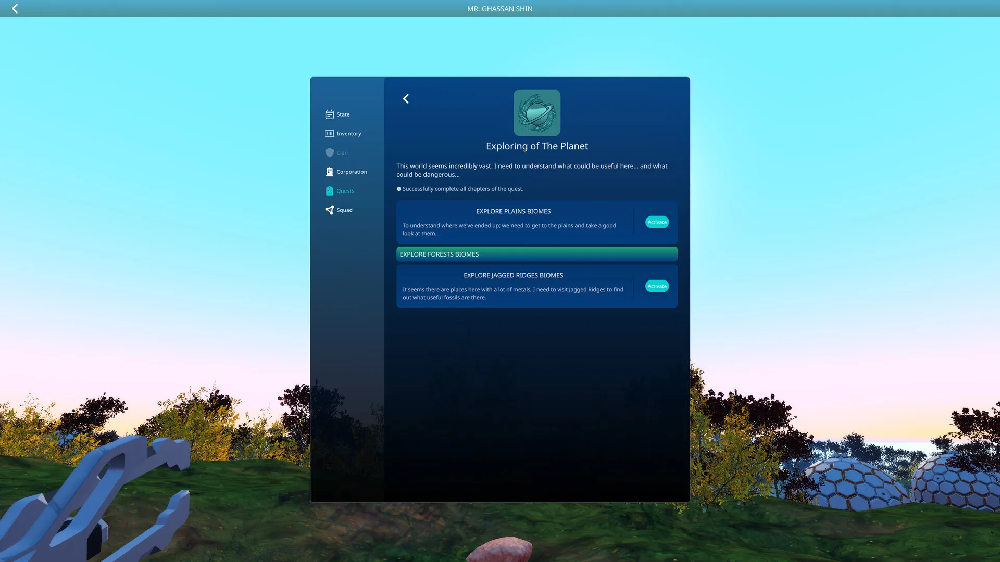
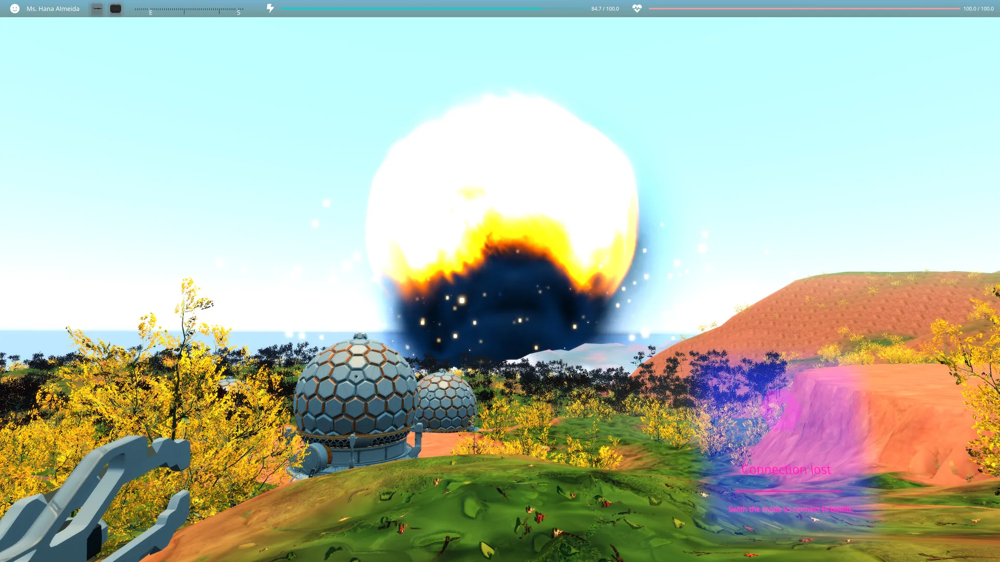

The **Demo 1.0** milestone keeps growing its combat toolbox, and the newest entry is the **grenade launcher** - a tool that fires small bombs on a two-second fuse.

## How it works

- The bomb **spawns when the tool is ready to launch** - no inventory juggling.
- Every bomb carries a **two-second timer** before it detonates.
- A spawned bomb can be **detonated early if it takes damage** - shoot your own grenade to clear a room.
- **Manual mode** - the first click loads a new bomb, the second click launches it.
- **Automatic mode** - the launcher reloads by itself after every shot.

## Where it fits

The launcher is one of the Demo 1.0 combat additions tracked on the milestone; together with the interactive, destructible world it gives the demo a proper feel test for the playtest group.

*From the [QuasarApp Core channel](https://www.youtube.com/@quasarappcore): Devlog #10 shows the interactive, destructible world the launcher's bombs are going to hit.*

