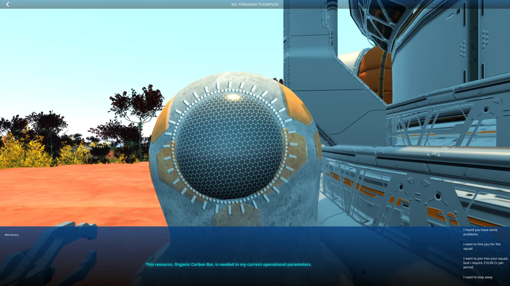

The **PreDemo 1.5** milestone (target: **November 30**) is the last pre-demo build before the next playtest round. It repeats the PreDemo 1.4 content and stacks the engine work that has been landing in the repository since the last build.

## What's new

- **CI smoke tests** - pull requests are smoke-tested automatically on Ubuntu, and the smoke test log is saved as a CI artifact, so regressions are caught before they reach a playtest build.
- **World generation rebuilt** - the legacy OpenSimplex2 noise library is replaced by FastNoise2 with SIMD (AVX2) batch generation; see the [engine insight post](/devlog/fastnoise2-world-generation/).
- **AI pathfinding** - a new `WalkByWay` walker pushes ordered walk commands along the shortest path, found with BFS/DFS over the world's `BiosphereGenerator` data.
- **Headless server** - the first step of the multiplayer track: `EclipticaServer` + `ServerWorld` run the simulation without a renderer.
- **Grenade launcher** - a new tool for Demo 1.0: small bombs with a two-second fuse in manual and automatic modes.

## What's next

The build is frozen on **November 30** and handed to the playtest group. The PreDemo 1.4 trailer below shows the content baseline that 1.5 stacks on top of.

*The PreDemo 1.4 trailer from the [QuasarApp Core YouTube channel](https://www.youtube.com/@quasarappcore) - 1.5 adds the engine work listed above to the same content.*

You can track the milestone on the [Ecliptica hub](/ecliptica.html) and join the conversation on [Discord](https://discord.gg/FRpw2565Sy).
