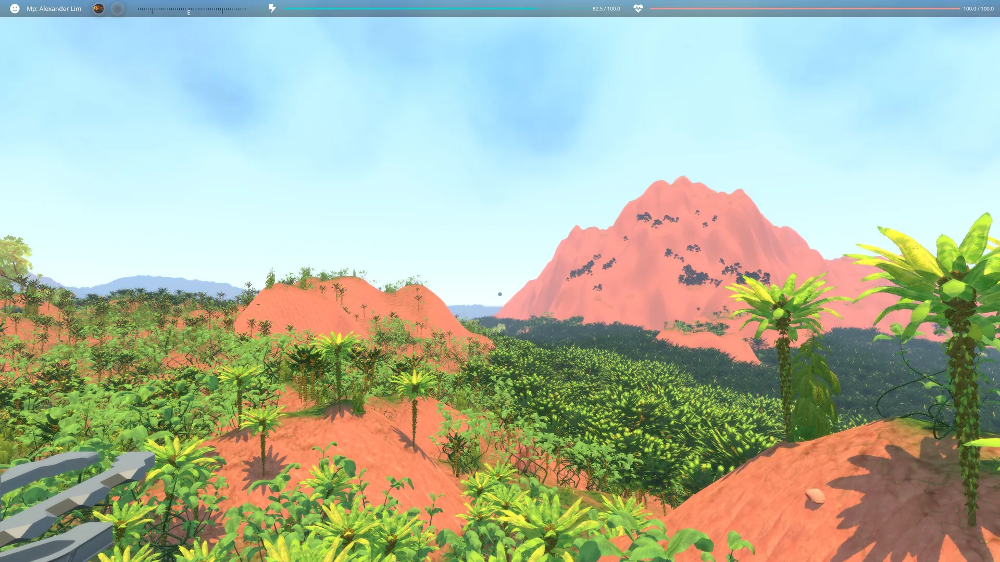

Co-op is one of the planned milestones on the [Ecliptica roadmap](/ecliptica.html#ecliptica-roadmap), and it starts with a question: can the world run without a client attached? The answer being built right now is **yes** - a dedicated `EclipticaServer` binary owns a headless `ServerWorld` that runs the full simulation with no renderer and no input.

## What the headless world owns

- **Entities and state** - colonists, NPCs, resources and colony state tick on the server clock.
- **Economy and contracts** - the dynamic, NPC-driven economy keeps running exactly as it does in singleplayer.
- **World rules** - terrain, biomes and destruction rules are evaluated server-side, so every client sees the same world.

## Why a separate process

Running the simulation in its own process keeps the client free to do what a client does best - render and accept input - and it mirrors how dedicated servers are operated in production. The implementation plan for the track lives in the Ecliptica repository's `docs/implementation-plans`; the current target branch is `multiplayer`.

A sketch of the server loop the track is building toward:

```cpp
// EclipticaServer: headless simulation tick (simplified)
ServerWorld world(config);
while (running) {
    world.tick(dt);            // entities, economy, world rules
    network.broadcast(world);  // ship the tick results to clients
}
```


*Placeholder clip - a capture of the server console will follow once the networking layer lands.*


