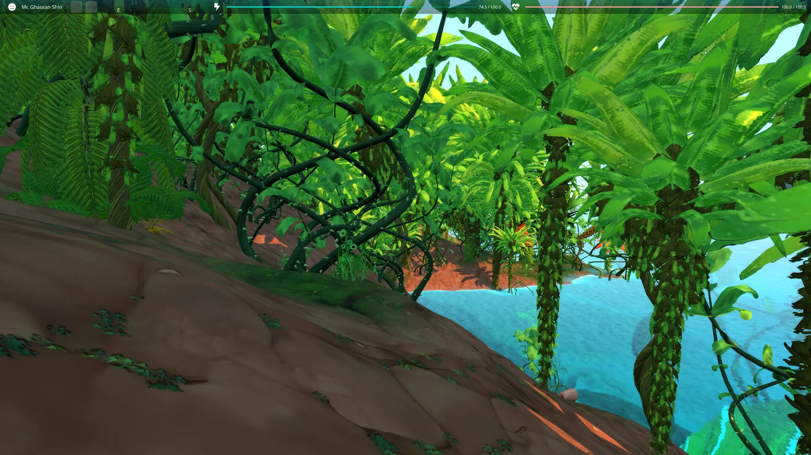

Terrain generation is one of the hottest loops in Ecliptica: the world is built from noise on the fly while you explore, and every column of terrain asks the noise function for a value. The legacy **OpenSimplex2** implementation answered those queries one point at a time - which left the CPU's vector units sitting idle.

## Why FastNoise2

[FastNoise2](https://github.com/Auburn/FastNoise2) is a modern noise library that generates samples in **SIMD batches** (SSE/AVX2 on desktop). Instead of asking for one value, the generator passes a contiguous memory block and receives a whole grid at once:

- The `extern/opensimplex2` submodule is removed; FastNoise2 is vendored as a git submodule under `extern/FastNoise2`.
- The world generators pass `std::vector<float>` blocks and use batch methods such as `GenUniformGrid2D` instead of per-point calls.
- Batch generation keeps the AVX2 pipeline saturated - the main reason the migration is faster than "the same algorithm, tuned".

## Batch generation in practice

The old call pattern looked like this:

```cpp
float height = opensimplex2.Sample(x, y); // one point, one call
```

The new pattern fills a grid in one batch call:

```cpp
std::vector<float> grid(width * height);
fastNoise.GenUniformGrid2D(grid.data(), width, height, originX, originY, cellSize);
```

One batch replaces thousands of per-point calls, and the noise library dispatches the widest SIMD tier the hardware supports.

## Determinism across platforms

A world generator must produce the **same world on every machine** - a save file or a multiplayer server is only as good as its determinism. New cross-platform tests (Google Test) pin the generated output and verify numerical consistency across hardware and SIMD tiers, so an AVX2 build and a scalar build generate the same terrain.


*Placeholder clip - the final world-generation capture is on the way. The generator's output is deterministic across platforms, so what you see here is what the playtest build will generate.*


